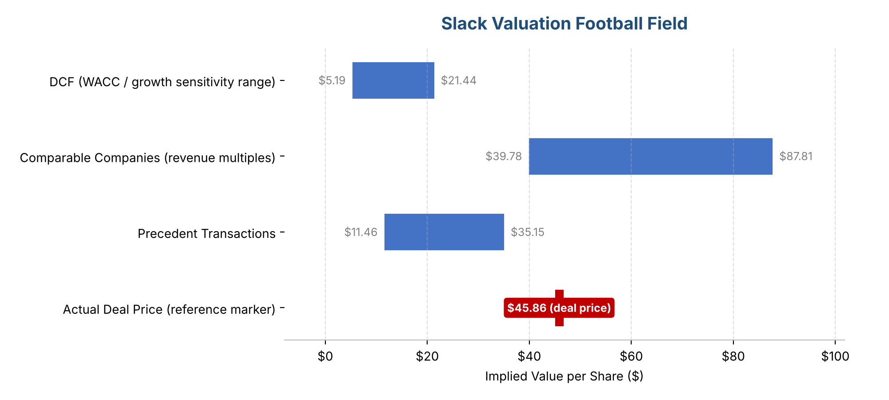
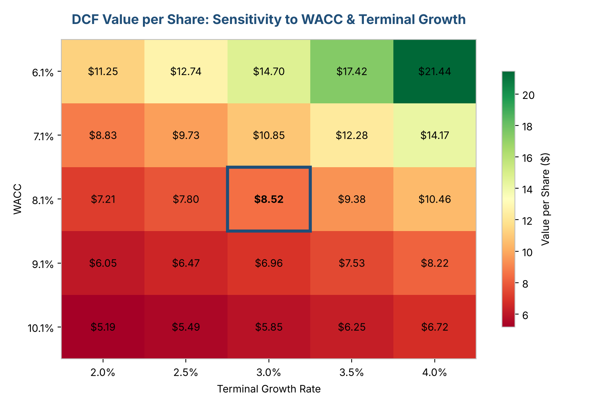
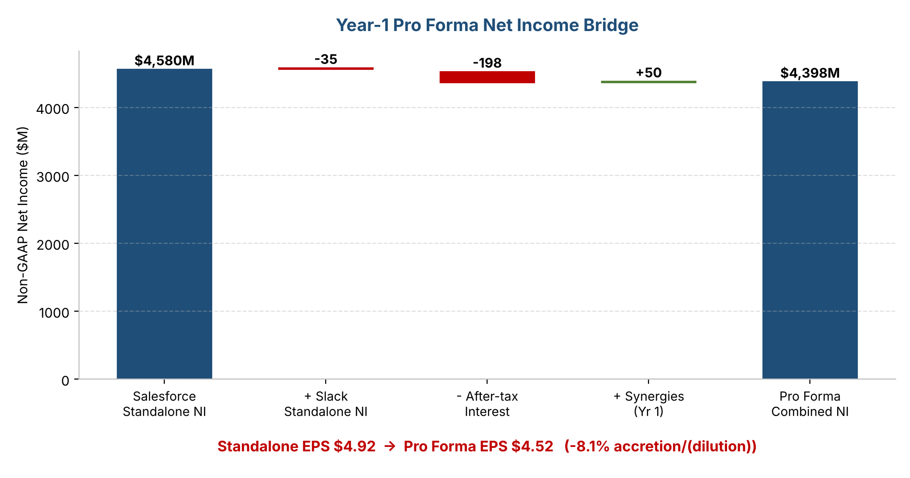

# Salesforce / Slack: M&A Valuation & Acquisition Recommendation

A full-cycle M&A analysis of Salesforce's $27.1B acquisition of Slack Technologies (announced Dec 2020, closed Jul 2021). Built as a portfolio project covering financial modeling, comparable-company research, and investment-committee-style writing.

**[Recommendation memo](memo/Recommendation_Memo.docx)** | **[Excel model](excel_model/SalesforceSlack_Valuation.xlsx)**

## Headline finding

Two "obvious" readings of this deal are both incomplete:

- *"Salesforce paid a huge premium, so it overpaid."* A standalone DCF puts Slack at about $8.50/share against a $45.86/share deal price. But a DCF applied to Slack's public peers would show a similar gap.
- *"The price matched peer trading multiples, so it was fair."* True, but only because Zoom, Atlassian and ServiceNow were trading at roughly 24x to 40x revenue in Dec 2020, an extreme pandemic-era valuation environment.

**Conclusion:** the price was rich on fundamentals but consistent with how the market was pricing comparable SaaS platforms at that moment. The real risk being underwritten was a market-wide multiple compression, which is what happened to SaaS valuations in 2022.

## Charts

| Football field | Sensitivity heatmap | EPS bridge |
|---|---|---|
|  |  |  |

## Repository structure

```
MA_Valuation_Project/
├── README.md
├── requirements.txt
├── excel_model/
│   └── SalesforceSlack_Valuation.xlsx   # 7-tab linked model
├── python/
│   ├── visualize.py                     # reads the Excel model, writes the charts
│   └── outputs/                         # 3 PNG charts
└── memo/
    └── Recommendation_Memo.docx         # 3-page recommendation memo
```

## The Excel model

Seven linked tabs. Every downstream tab and every chart reads from the Assumptions tab, so changing an input updates everything.

| Tab | Purpose | Key output |
|---|---|---|
| Assumptions | All inputs, sourced or flagged | n/a |
| DCF | 5-year unlevered FCF model for Slack standalone | ~$8.52/share base case |
| Comps | Dec-2020/Jan-2021 trading multiples: Zoom, Atlassian, ServiceNow | $39.78 to $87.81/share |
| Precedent Transactions | 5 enterprise SaaS deals incl. Salesforce/MuleSoft | $11.46 to $35.15/share |
| Deal Structure | Sources & uses, new shares issued, accretion/dilution | ~8.1% dilutive to Year-1 EPS |
| Sensitivity | DCF value vs. WACC and terminal growth | $5.19 to $21.44/share |
| Football Field | Summary chart of all methods vs. deal price | n/a |

Colour convention: blue = hardcoded input, black = formula, green = cross-sheet link, yellow fill = key assumption worth double-checking.

## Data sources

- Deal terms: Salesforce 10-Q (FY2021, Note 6) and the BusinessWire announcement
- Slack and Salesforce financials: FY2021 results press releases
- Comps: Zoom FY2021 10-K, Atlassian FY2021 filings, ServiceNow FY2020 10-K plus year-end 2020 market caps (market cap used as an EV proxy; none carried meaningful net debt)
- Precedent deals: publicly reported multiples

Inputs that were not publicly disclosed (WACC components, Slack's standalone net income, acquisition-debt pricing) are clearly flagged illustrative assumptions in the Assumptions tab.

## Re-generate the charts

```bash
pip install -r requirements.txt
python python/visualize.py
```

If you change an assumption, edit it in Excel, save the file (so formula values are cached), then rerun the script.

## Limitations

- Built from public filings and press coverage, not a data terminal (FactSet/CapIQ), so some inputs (exact betas, EV on the announcement date) are best-effort estimates.
- Slack's standalone net income for accretion/dilution is estimated from its non-GAAP operating loss.
- The DCF uses a simple revenue-deceleration and margin-ramp model, not a bottom-up build.
